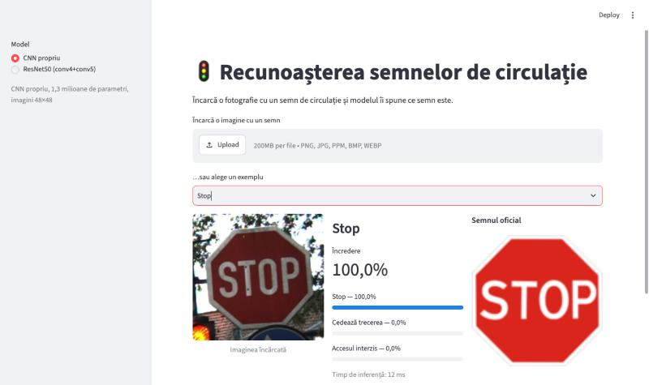
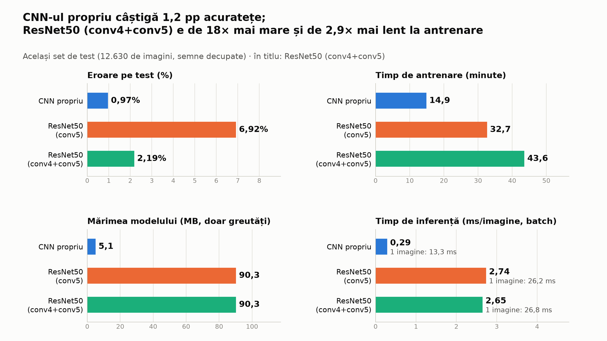
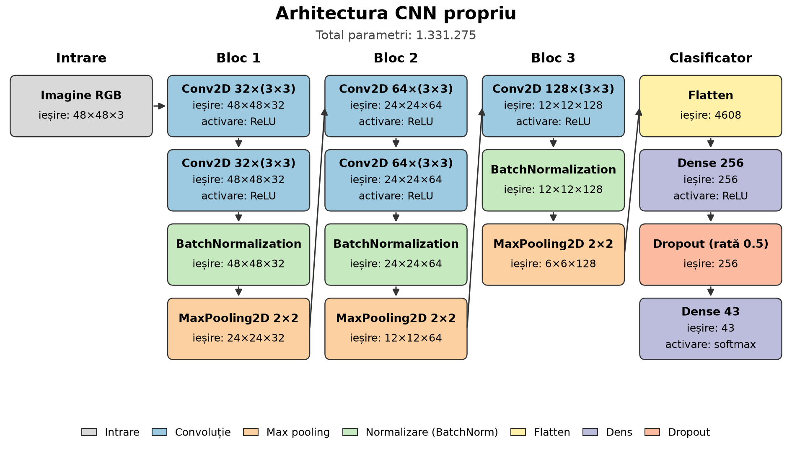
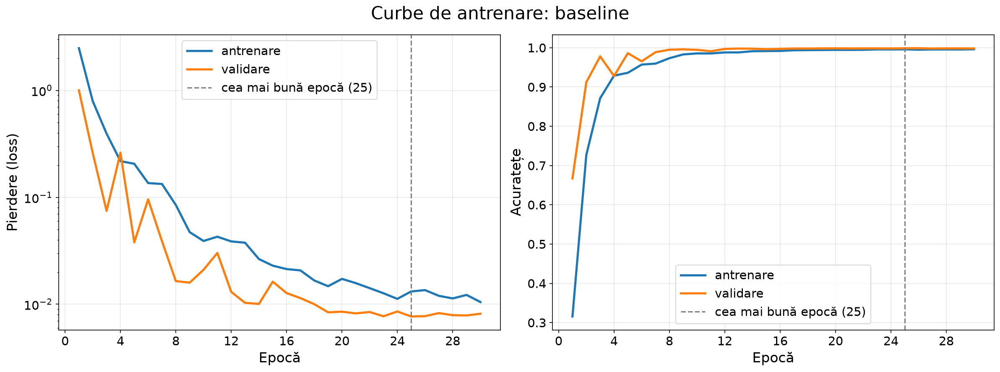

# 🚦 Recunoașterea semnelor de circulație (GTSRB)

Proiect pentru cursul **Tehnici de Inteligență Artificială**. Clasificăm imagini cu semne de circulație în **43 de clase**, pe setul german [GTSRB](https://benchmark.ini.rub.de/gtsrb_news.html), cu:

- o **rețea convoluțională proprie (CNN)**, construită de la zero în TensorFlow/Keras;
- o **arhitectură consacrată, ResNet50**, pre-antrenată pe ImageNet și adaptată prin fine-tuning;
- o **aplicație web Streamlit**, în care încarci o imagine și afli ce semn este.



---

## Rezultate

Toate modelele sunt evaluate pe setul de **test** GTSRB (12.630 de imagini pe care modelul nu le-a văzut la antrenare).

| Model | Acuratețe test | F1 (macro) | Parametri | Mărimea ponderilor | Timp / imagine* |
|---|---:|---:|---:|---:|---:|
| **CNN propriu** | **99,03%** | **98,29%** | 1,3 mil. | 5,1 MB | 0,29 ms |
| ResNet50 (dezghețat `conv5`) | 93,08% | 90,60% | 23,7 mil. | 90,3 MB | 2,7 ms |
| ResNet50 (dezghețat `conv4`+`conv5`) | 97,81% | 96,68% | 23,7 mil. | 90,3 MB | 2,6 ms |

\* pe CPU (Apple M4 Pro), imagini procesate în batch.

**Concluzie:** pe imagini mici (25–243 px) și pe o singură temă (semne), CNN-ul propriu este **mai precis**, de **18× mai mic** și de **~9× mai rapid** decât ResNet50. Rețelele mari pre-antrenate ajută mai ales când datele sunt puține sau foarte variate.



Alte experimente cu CNN-ul (aceeași arhitectură):

| Experiment | Acuratețe test | Ce arată |
|---|---:|---|
| `baseline` (cu dropout + augmentare) | 99,03% | modelul principal |
| `no_reg` (fără dropout, fără augmentare) | 98,31% | **overfitting**: învață pe de rost datele de antrenare |
| `no_crop` (antrenat pe imagini nedecupate) | 98,46%** | modelul folosit în aplicație |

\** pe imagini de test nedecupate. Pe aceleași imagini, `baseline` scade la 91,77%, pentru că a văzut la antrenare doar semne decupate strâns. De aceea aplicația folosește `no_crop`: pozele încărcate de utilizator nu sunt decupate.

---

## Instalare

### 1. Cerințe
- **Python 3.12**
- [**uv**](https://docs.astral.sh/uv/) (recomandat): `curl -LsSf https://astral.sh/uv/install.sh | sh`
- ~2 GB spațiu liber (TensorFlow + setul de date)

### 2. Codul și mediul

```bash
git clone <URL-ul-repository-ului>
cd Tehnici_Inteligenta_Artificiala
uv sync
```

`uv sync` creează mediul virtual `.venv/` și instalează exact versiunile din `uv.lock` (TensorFlow 2.21, Streamlit etc.).

<details>
<summary>Fără uv (cu pip)</summary>

```bash
python3.12 -m venv .venv
source .venv/bin/activate          # Windows: .venv\Scripts\activate
pip install -r requirements.txt
pip install -e .
```
Apoi rulează comenzile de mai jos fără prefixul `uv run`.
</details>

### 3. Setul de date (doar pentru antrenare și evaluare)

Aplicația **nu** are nevoie de setul de date: imaginile oficiale ale semnelor și câteva exemple sunt deja în `app/assets/`.

Pentru antrenare și evaluare, descarcă GTSRB de pe Kaggle ([GTSRB – German Traffic Sign Recognition Benchmark](https://www.kaggle.com/datasets/meowmeowmeowmeowmeow/gtsrb-german-traffic-sign)) și dezarhivează-l în folderul `archive/`:

```
archive/
├── Meta/        # 43 de imagini oficiale (câte una pe clasă)
├── Test/        # 12.630 de imagini de test
├── Train/       # 39.209 imagini de antrenare, în 43 de subfoldere
├── Meta.csv
├── Test.csv
└── Train.csv
```

---

## Utilizare

### Aplicația web

```bash
uv run streamlit run app/streamlit_app.py
```

Se deschide în browser la **http://localhost:8501**. Primul start durează ~10 secunde (se încarcă TensorFlow).

**Exemplu de utilizare:**
1. În bara din stânga alegi modelul: **CNN propriu** sau **ResNet50**.
2. Apeși **Upload** și alegi o poză cu un semn (PNG, JPG, PPM, BMP sau WEBP), sau alegi un **exemplu** din listă (de ex. „Stop”).
3. Aplicația afișează:
   - **semnul recunoscut** și **încrederea** (ex. „Stop, 100,0%”);
   - **top 3** variante, cu bare de probabilitate;
   - **imaginea oficială** a semnului, pentru comparație;
   - timpul de răspuns al modelului;
   - la exemple, și răspunsul corect (✅ / ❌).

Sfaturi:
- Merge cel mai bine când semnul ocupă cea mai mare parte a imaginii.
- Sub 50% încredere, aplicația te avertizează că nu e sigură.
- Modelul cunoaște doar cele **43 de semne germane** din GTSRB. Pe o imagine care nu e un semn va alege totuși una dintre ele, pentru că un clasificator nu are opțiunea „niciunul”.

> **ResNet50 în aplicație:** fișierul modelului are ~260 MB, deci nu e pus pe GitHub. Aplicația pornește doar cu CNN-ul și îți arată comanda de adăugare. Ca să-l ai, antrenează-l (vezi mai jos), apoi:
> ```bash
> uv run python scripts/promote_model.py --run-name resnet50_conv4 --as resnet50_conv4
> ```

### Antrenare (opțional; modelul CNN e deja în `models/`)

```bash
# 1. Împărțirea train / validare (pe „track-uri”, ca aceeași bucată de stradă să nu fie în ambele)
uv run python scripts/make_split.py

# 2. CNN-ul propriu (~15 min pe CPU)
uv run python scripts/train_cnn.py --run-name baseline
uv run python scripts/train_cnn.py --run-name no_crop --no-crop
uv run python scripts/train_cnn.py --run-name no_reg --dropout 0 --no-augment

# 3. ResNet50 în două etape (~45 min pe CPU)
uv run python scripts/train_resnet.py --run-name resnet50_conv4 --unfreeze conv4+conv5 --stage2-epochs 15
```

Fiecare antrenare salvează în `runs/<nume>/`: modelul (`model.keras`), setările (`config.json`) și istoricul pe epoci (`history.csv`).

### Evaluare pe setul de test

```bash
uv run python scripts/evaluate.py --run-name baseline                       # metrici, matrice de confuzie, curbe
uv run python scripts/evaluate.py --run-name baseline --no-crop             # pe imagini nedecupate
uv run python scripts/evaluate.py --run-name resnet50_conv4 --out reports/m5
uv run python scripts/compare_runs.py                                       # tabelul experimentelor CNN
uv run python scripts/compare_models.py                                     # CNN vs. ResNet50 + figura
uv run python scripts/make_presentation_figures.py                          # graficele pentru prezentare
```

### Teste

```bash
uv run pytest -q
```

132 de teste automate (preprocesare, împărțirea datelor, augmentare, modele, antrenare, evaluare, aplicație). Rulează în ~30 de secunde, pe date mici generate, fără setul real.

---

## Cum funcționează

### Pregătirea datelor
- **Împărțire train / validare pe track-uri:** GTSRB are câte 30 de cadre consecutive din același semn fizic („track”). Le ținem pe toate în același set, ca validarea să nu conțină aproape-duplicate ale imaginilor de antrenare. Rezultă 33.359 de imagini train și 5.850 validare, 85% / 15%, cu 0 track-uri comune.
- **Preprocesare:** decupare pe zona semnului (ROI), redimensionare la 48×48 (CNN) sau 96×96 (ResNet50), valori în [0, 1]. Aceeași funcție e folosită la antrenare și în aplicație.
- **Augmentare:** rotire ±15°, zoom, deplasare, luminozitate și contrast. **Fără oglindire**, pentru că un semn oglindit („obligatoriu la dreapta”) devine alt semn.
- **Clase dezechilibrate** (între 210 și 2.250 de imagini pe clasă): ponderi pe clase la antrenare.

### Arhitectura proprie (CNN)



- 3 blocuri convoluționale (32 → 64 → 128 de filtre, cu BatchNorm și MaxPooling), apoi Dense 256, **Dropout 0,5** și Softmax pe 43 de clase. În total 1,33 milioane de parametri.
- Optimizator Adam (rata de învățare 1e-3), loss *categorical cross-entropy*, batch 64, maxim 30 de epoci.
- **EarlyStopping** oprește antrenarea când validarea nu se mai îmbunătățește. **ReduceLROnPlateau** micșorează rata de învățare când loss-ul stagnează.
- **Reproductibilitate:** seed fix `42` pentru Python, NumPy și TensorFlow.



### ResNet50 (transfer learning)
- Ponderi ImageNet, cu un cap nou: GlobalAveragePooling, Dropout 0,3 și Dense 43.
- **Etapa 1:** baza e înghețată și se antrenează doar capul (5 epoci, lr 1e-3).
- **Etapa 2:** se dezgheață ultimele blocuri (`conv5`, respectiv `conv4`+`conv5`), cu o rată de învățare de 10× mai mică (1e-4). Straturile BatchNorm rămân înghețate.

### Aplicația
- `src/traffic_signs/inference.py` conține logica: citirea imaginii (cu mesaje clare pentru fișiere greșite și cu rotirea pozelor de telefon după EXIF), predicția și top 3.
- `app/streamlit_app.py` este doar interfața; modelele se încarcă o singură dată și rămân în memorie.

---

## Structura proiectului

```
├── app/
│   ├── streamlit_app.py      # aplicația web
│   └── assets/               # imaginile oficiale ale semnelor + exemple
├── src/traffic_signs/        # codul proiectului (pachet Python)
│   ├── config.py             # constante: seed, mărimi imagini, căi
│   ├── classes.py            # numele celor 43 de semne, în română
│   ├── dataset.py, split.py  # citirea setului și împărțirea train/validare
│   ├── preprocessing.py      # încărcare, decupare, redimensionare
│   ├── augmentation.py       # augmentare + ponderi pe clase
│   ├── pipeline.py           # tf.data pentru antrenare
│   ├── models.py             # CNN propriu + ResNet50
│   ├── training.py           # antrenare (o etapă / două etape)
│   ├── evaluation.py         # metrici, matrice de confuzie, grafice
│   ├── comparison.py         # comparația CNN vs. ResNet50
│   └── inference.py          # predicția folosită de aplicație
├── scripts/                  # comenzi pentru split, antrenare, evaluare, grafice
├── tests/                    # testele automate (pytest)
├── notebooks/                # notebook explicativ, pas cu pas, al preprocesării
├── models/                   # modelele CNN antrenate (cnn_baseline, cnn_no_crop)
├── reports/                  # metrici, tabele și grafice (inclusiv pentru prezentare)
├── splits/                   # împărțirea train/validare salvată
├── pyproject.toml, uv.lock   # dependențele
└── requirements.txt          # dependențele, pentru pip
```

---

## Tehnologii
Python 3.12 · TensorFlow 2.21 / Keras 3 · Streamlit · NumPy · pandas · Pillow · scikit-learn · Matplotlib · pytest · uv

## Set de date
J. Stallkamp, M. Schlipsing, J. Salmen, C. Igel, *The German Traffic Sign Recognition Benchmark: A multi-class classification competition*, IJCNN 2011.
